

 

<a href="https://tektonxyz.xyz/"><b>tektonxyz.xyz</b></a> &nbsp;·&nbsp; <a href="https://x.com/Tekton_XYZ"><b>x.com/Tekton_XYZ</b></a>

 

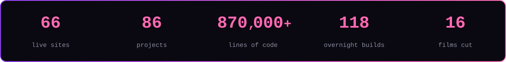

 

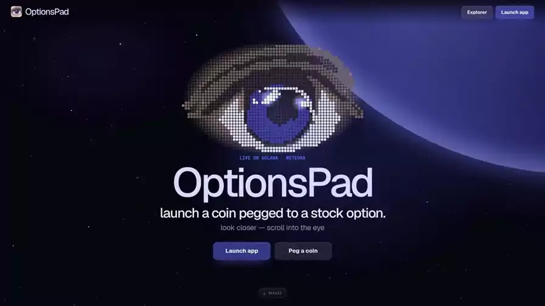

 

<a href="https://thegoldrush.fun">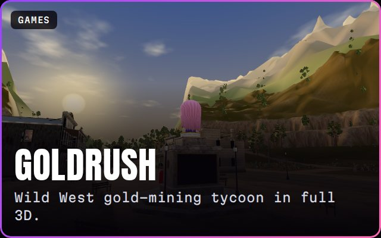</a>
<a href="https://mettpad.com">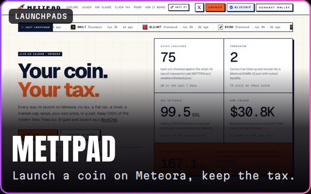</a>
<a href="https://optionspad.fun">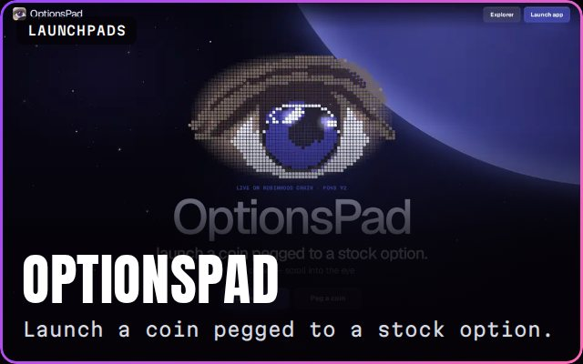</a>
<a href="https://businesspad.world">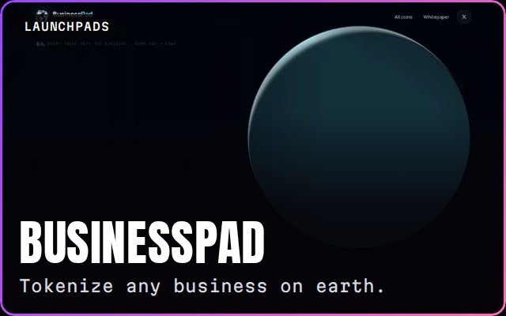</a>
<a href="https://manticore.fun">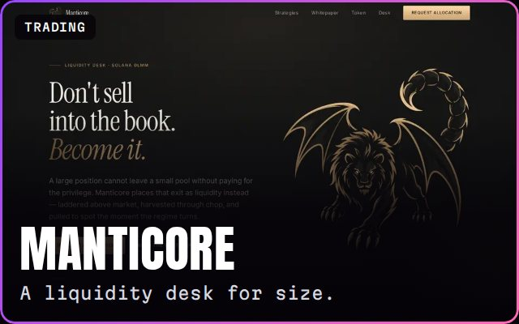</a>
<a href="https://ztek.agency">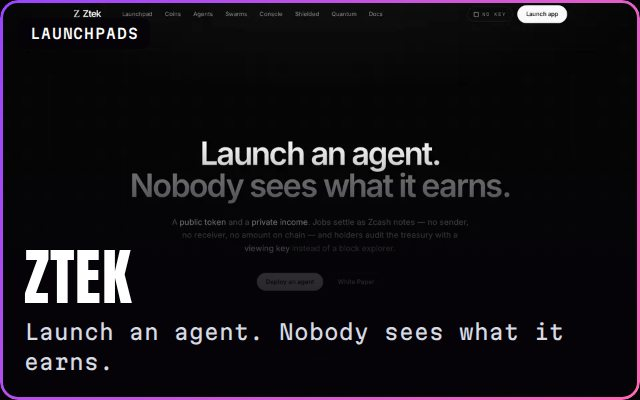</a>
<a href="https://unlistedotc.com">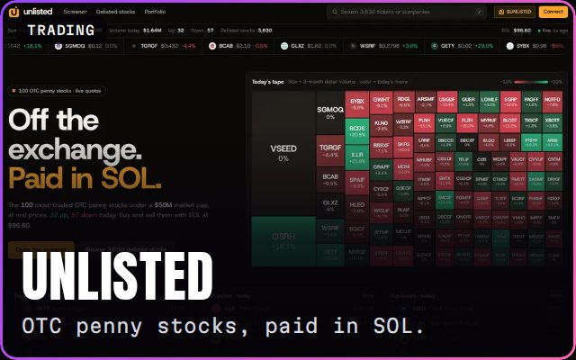</a>
<a href="https://0xcpu.fun">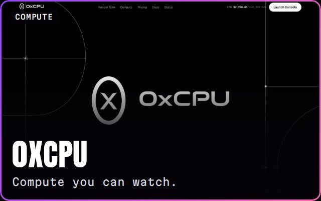</a>
<a href="https://liqft.fun">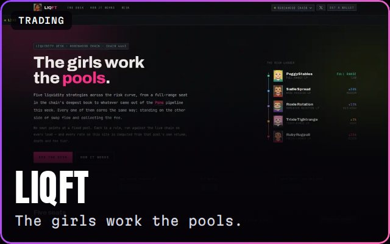</a>
<a href="https://omitrades.xyz">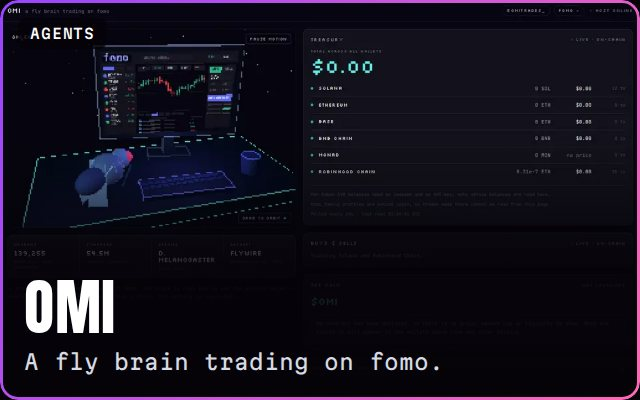</a>
<a href="https://www.openfly.world">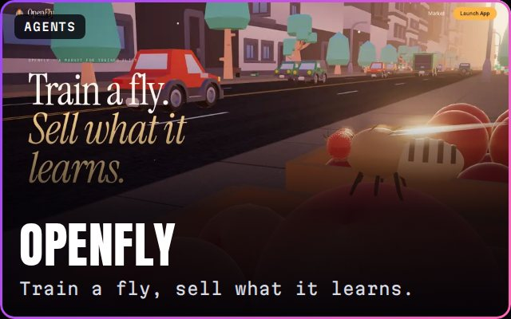</a>
<a href="https://defi-street.netlify.app">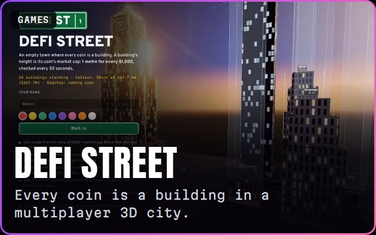</a>

 


 

 

