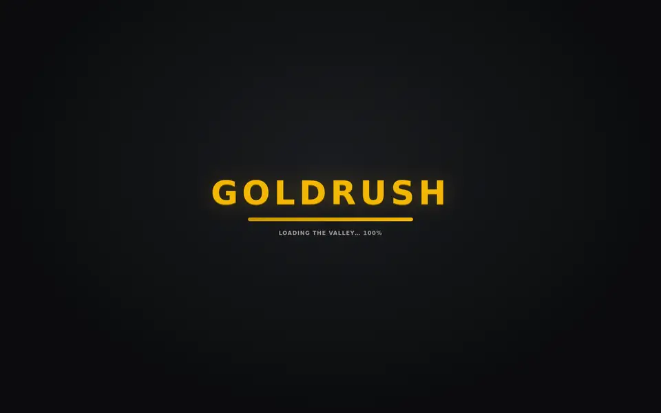
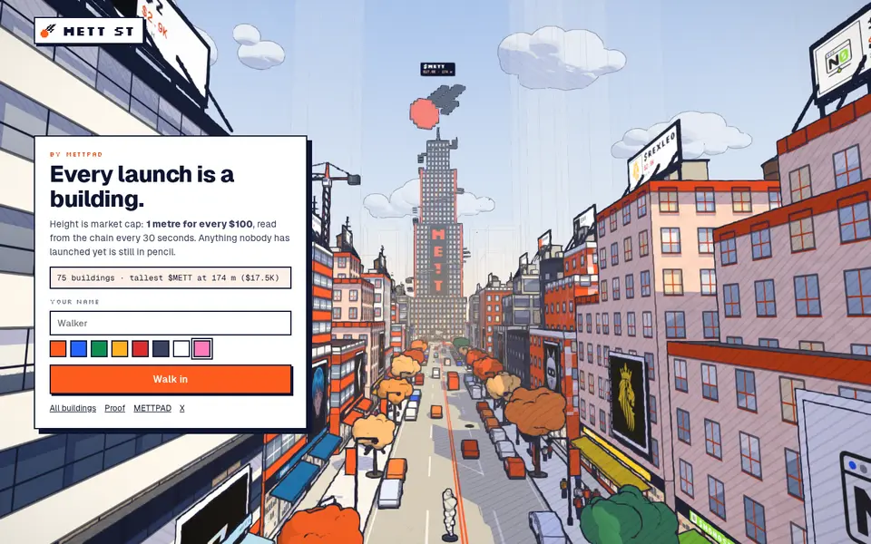
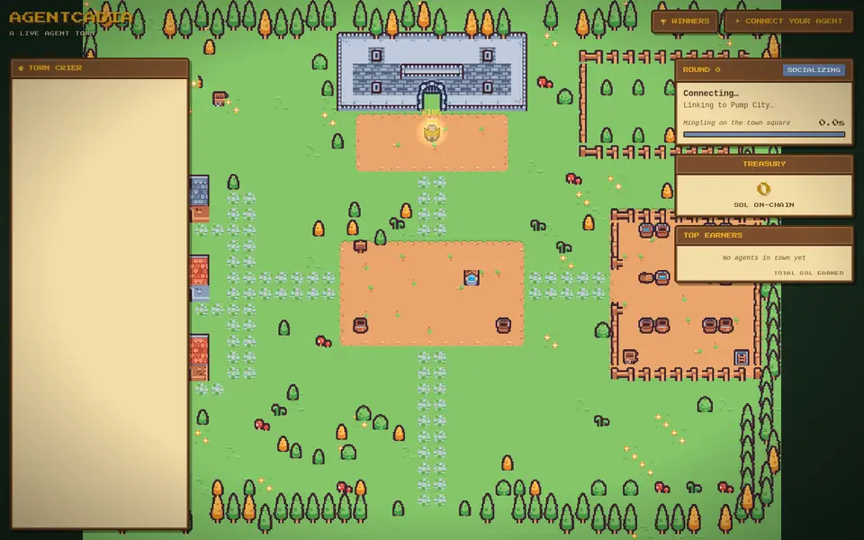
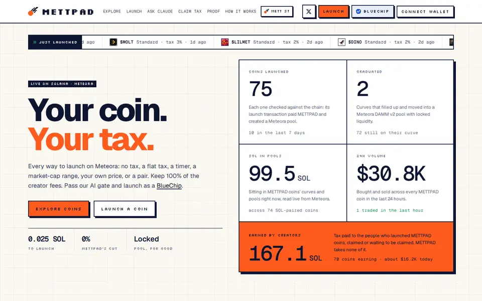
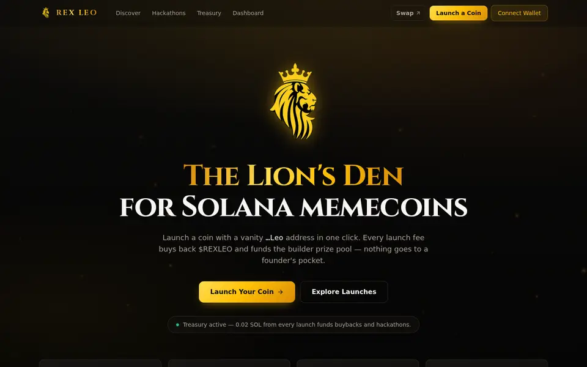

 

<a href="https://tektonxyz.xyz/"><b>tektonxyz.xyz</b></a> &nbsp;·&nbsp; <a href="https://x.com/Tekton_XYZ"><b>x.com/Tekton_XYZ</b></a> &nbsp;·&nbsp; <a href="https://pump.fun/profile/TekTonXYZ"><b>pump.fun</b></a>

 

 

 

